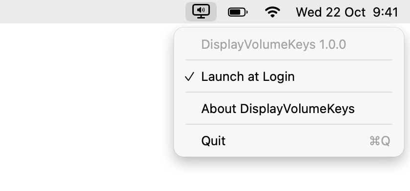
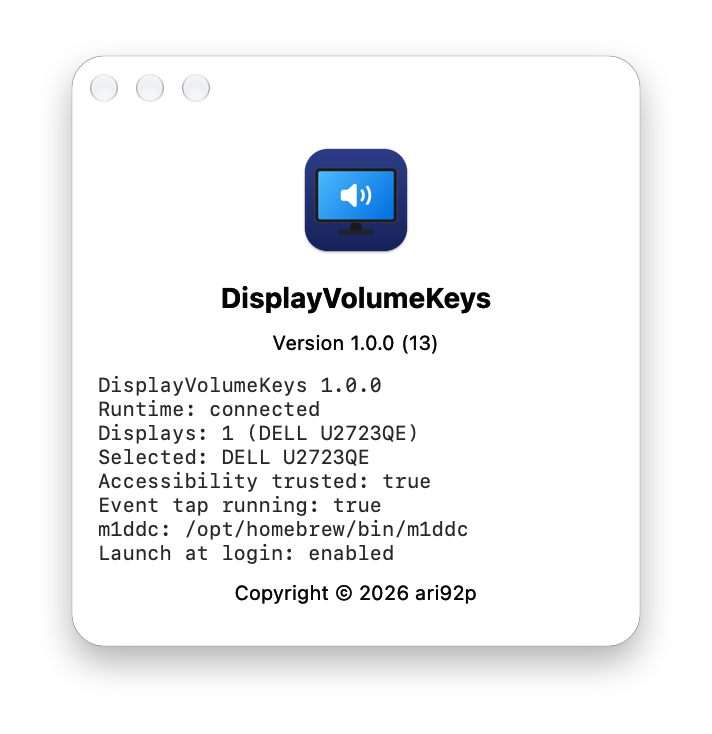

<h1>
  DisplayVolumeKeys
  <a href="https://github.com/ari92p/display-volume-keys/releases/latest">
    
  </a>
</h1>

**Make the volume keys on your Mac control the speakers of your external
monitor.**

When a Mac sends audio to an external display over USB-C, DisplayPort,
Thunderbolt or HDMI, the volume keys usually stop working: macOS shows a
crossed-out speaker, and the volume can only be changed with the buttons on
the monitor. DisplayVolumeKeys is a small menu bar app that fixes this. It
sends the volume up, volume down and mute keys to the display over DDC/CI,
the same channel the monitor's own menu uses.

It does only this one job, needs no configuration and runs entirely on your
Mac.

<picture>
  <source media="(prefers-color-scheme: dark)" srcset="assets/menu-dark.png">
  
</picture>

## Installation with Homebrew

```sh
brew install --cask ari92p/tap/display-volume-keys
```

This also installs [`m1ddc`](https://github.com/waydabber/m1ddc), which
DisplayVolumeKeys uses to talk to the display. Then:

1. Open DisplayVolumeKeys from the Applications folder.
2. Allow DisplayVolumeKeys under **System Settings → Privacy & Security →
   Accessibility** when macOS asks. This lets it receive the volume keys.

A monitor icon now appears in the menu bar. It is dimmed while the app leaves
the volume keys to macOS, for example when no DDC display is connected.
DisplayVolumeKeys starts automatically at login; turn this off with **Launch at
Login** in its menu.

Update with `brew upgrade --cask display-volume-keys`. The Accessibility
permission stays in place across updates.

DisplayVolumeKeys is signed with the project's own certificate but not
notarized by Apple, which requires a paid developer account. The Homebrew cask
therefore removes the download quarantine from the app, so macOS does not
block the first start.

## Features

- Volume up, volume down and mute go to the external display
- Holding or repeating a key speeds up the change, up to four steps at a time
- Becomes active only while the external display is the selected macOS sound
  output; otherwise the keys keep working as usual
- Never changes the macOS sound output device
- Finds the display automatically, no settings needed
- Stays inactive when it cannot tell which display to control, instead of
  guessing
- Starts at login, which can be turned off in the menu bar
- English and German interface
- No telemetry and no network access

## Requirements

- A Mac with Apple silicon (M1 or newer)
- macOS 13 Ventura or later
- An external display with built-in speakers whose volume can be changed over
  DDC/CI
- [`m1ddc`](https://github.com/waydabber/m1ddc), installed automatically by
  Homebrew

To check whether your display supports this, run `m1ddc get volume` in
Terminal. If it prints a number, DisplayVolumeKeys will work with it.

## Installation from a GitHub release

1. Install `m1ddc` with `brew install m1ddc`.
2. Download the ZIP from the latest
   [release](https://github.com/ari92p/display-volume-keys/releases/latest)
   and move `DisplayVolumeKeys.app` to the Applications folder.
3. Open the app. macOS blocks the first start because the app is not
   notarized: open **System Settings → Privacy & Security**, scroll down and
   click **Open Anyway**. This is needed again after each manual update.
4. Allow DisplayVolumeKeys under **System Settings → Privacy & Security →
   Accessibility** when macOS asks.

## Troubleshooting

- **The volume keys still show the crossed-out speaker:** check that
  DisplayVolumeKeys is enabled under **Privacy & Security → Accessibility** and
  that the external display is the selected sound output.
- **No DDC display found:** run `m1ddc display list` and `m1ddc get volume` in
  Terminal. Some monitors turn DDC/CI off by default; look for a "DDC/CI"
  option in the monitor's on-screen menu. The built-in HDMI port of some Macs
  and many docks and adapters do not pass DDC through; a direct USB-C or
  DisplayPort connection usually works.
- **Multiple DDC displays found:** with more than one compatible display,
  DisplayVolumeKeys intentionally stays inactive rather than guessing.
- **Another app reacts to the volume keys too:** turn off volume key handling
  in MonitorControl, BetterDisplay or similar utilities so that only one app
  handles the keys.
- **`m1ddc` is installed somewhere else:** DisplayVolumeKeys looks in
  `/opt/homebrew/bin` and `/usr/local/bin`. Set a different path with
  `defaults write io.github.ari92p.DisplayVolumeKeys M1DDCPath /path/to/m1ddc`
  and restart the app.

**About DisplayVolumeKeys** in the menu bar shows a diagnostic report you can
copy into an issue.

<picture>
  <source media="(prefers-color-scheme: dark)" srcset="assets/about-dark.png">
  
</picture>

## How it compares

[MonitorControl](https://github.com/MonitorControl/MonitorControl),
[BetterDisplay](https://github.com/waydabber/BetterDisplay) and
[Lunar](https://lunar.fyi) can also control monitor volume, alongside
brightness, contrast and much more. DisplayVolumeKeys is for people who only
want the volume keys to work: it has no windows, no settings and no
brightness control.

## Building from source

Swift 6 is required. With a full Xcode installation, the build also runs the
XCTest suite.

```sh
./build.sh
```

The app is written to `dist/DisplayVolumeKeys.app`. The build always runs the
portable unit and fail-safe checks, then compiles a release binary, assembles
the app bundle and signs it.

macOS ties the Accessibility permission to the app's signing certificate. To
keep the permission across rebuilds, create a local signing certificate once:

```sh
scripts/create-signing-identity.sh ~/DisplayVolumeKeys-signing
```

`build.sh` then uses it automatically. For an ad-hoc signed test build, run
`DISPLAY_VOLUME_KEYS_SIGN_IDENTITY=- ./build.sh`, or pass the name of any other
signing identity in that variable.

To replace the installed app with a local build, run `./install.sh`. It quits
the running app, installs the new build to `/Applications`, keeps the previous
version for recovery and starts the app again. It refuses ad-hoc builds so
that the installed app keeps its signing identity.

## Project layout

```text
Sources/DisplayVolumeKeys/              Core DDC and command logic
Sources/DisplayVolumeKeysApp/           AppKit menu bar application
Sources/DisplayVolumeKeysVerification/  Executable verification suite
Tests/DisplayVolumeKeysTests/           XCTest unit and service tests
Resources/                              Metadata, app icon and localizations
scripts/                                Signing and release helpers
build.sh                                Build, verify, package and sign
install.sh                              Install a local build
```

## Privacy and security

DisplayVolumeKeys runs entirely on the local Mac. It does not collect
telemetry, does not make network requests and does not change the selected
sound output. The diagnostic report shows display names but no stable display
identifiers, and display identifiers are not stored.

Please report vulnerabilities as described in [SECURITY.md](SECURITY.md).

## Support

If this app is useful to you, you can buy me a coffee:

<p>
  <a href="https://ko-fi.com/ari92p"></a>
  <a href="https://buymeacoffee.com/ari92p"></a>
</p>

## Contributing

Contributions are welcome. See [CONTRIBUTING.md](CONTRIBUTING.md) before
opening a pull request.

## Credits and license

DisplayVolumeKeys uses [`m1ddc`](https://github.com/waydabber/m1ddc) by
waydabber (MIT License), which is installed separately and not bundled.

DisplayVolumeKeys is available under the [MIT License](LICENSE).
